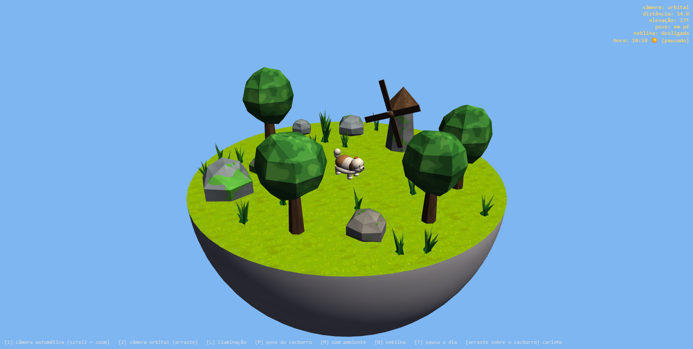

# Paraíso dos Dogs

Cena 3D em WebGL feita para o Trabalho Prático 2 de Computação Gráfica.

- Cena publicada: https://analuizareiss.github.io/paraiso-dos-dogs
- Repositório: https://github.com/analuizareiss/paraiso-dos-dogs

## A Cena

Um diorama dentro de uma pokébola: um shih tzu vive sobre um chão de grama circular, com um hemisfério embaixo, cercado de árvores, pedras com musgo, tufos de mato e um moinho de vento de pedra com as pás girando.

O cachorro alterna entre três poses (em pé, sentado na borda e dormindo de barriga para cima) e reage a carinho com o mouse. O dia passa do amanhecer à noite, mudando a luz e a cor do céu, com som ambiente de fundo e uma neblina que pode ser ligada.

**Controles**

| Tecla / ação | O que faz |
|---|---|
| `1` | câmera automática: 45º acima do chão, girando em volta do diorama; o scroll aproxima e afasta |
| `2` | câmera orbital: arraste o mouse para girar em volta do centro |
| `L` | liga e desliga a iluminação |
| `P` | alterna a pose do cachorro |
| `N` | liga e desliga a neblina |
| `T` | pausa e retoma o ciclo dia/noite |
| `M` | liga e desliga o som ambiente |
| arrastar sobre o cachorro | carinho |

> O som só começa depois do primeiro clique ou tecla, porque os navegadores bloqueiam áudio antes de uma interação.

## Criadoras

| Nome | Contato |
|------|---------|
| Ana Luiza Reis e Silva | [LinkedIn](https://www.linkedin.com/in/ana-luiza-reis-7307812a4/) |
| Bianca Marçal Pacífico | [LinkedIn](https://www.linkedin.com/in/biancapacifico/) |

## Media kit

<!-- Um terceiro screenshot (ex.: noite ou neblina ligada) pode entrar aqui:

-->

## Opcionais

- **Poses alternativas**: ao alternar as poses do personagem com `P`, além de mudar a posição e orientação, coloque-o de fato em outra pose (eg, sentado, deitado, dormindo)
  - Onde ver: `src/cachorro.js`
- ⭐ **Interação** (carinho): torne possível fazer um carinho no bichinho usando o mouse. Deve ter algum *feedback*: emitir um som, animação de alegria, surgir um balãozinho com rosto feliz etc.
  - Onde ver: `src/carinho.js` e `src/cachorro.js` (animação de alegria)
- 🍔 **Ciclo dia/noite**: faça o tempo passar e que isso defina na forma como o cenário é renderizado. Isso pode ser feito configurando-se a fonte de luz direcional com cores diferentes, dependendo da hora do dia
  - Se tiver um *skybox*, você deve alterá-lo para refletir os horários diferentes
  - Onde ver: `src/ciclo.js`
- 🌟 **Neblina**: funcionalidade acrescentada por comando do teclado (`N`), podendo ser habilitada e desabilitada durante a execução
  - Onde ver: `src/shaders/phong.frag`
- 🌟 **Música, efeitos sonoros e/ou som ambiente**: inclua música de fundo, sons ambiente e efeitos sonoros (este último, caso haja algum tipo de interação)
  - Onde ver: `src/ambiente.js`

## Créditos

- Biblioteca [TWGL.js](https://twgljs.org/)
- Som ambiente (`assets/ambiente.mp3`): [Nature Forest Sound] — [SoundReality] — [[LINK](https://pixabay.com/sound-effects/film-special-effects-nature-forest-sound-537925/)]