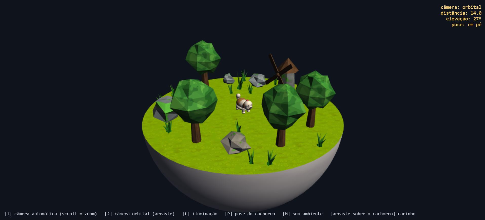

# Paraíso dos Dogs

Cena 3D em WebGL feita para o Trabalho Prático 2 de Computação Gráfica.

- Cena publicada: https://analuizareiss.github.io/paraiso-dos-dogs
- Repositório: https://github.com/analuizareiss/paraiso-dos-dogs

## A Cena

Um diorama dentro de uma pokébola: um shih tzu vive sobre um chão de grama circular, com um hemisfério embaixo, cercado de árvores, pedras com musgo, tufos de mato e um moinho de vento de pedra com as pás girando.

O cachorro alterna entre três poses (em pé, sentado na borda e dormindo de barriga para cima) e reage a carinho com o mouse.

**Controles**

| Tecla / ação | O que faz |
|---|---|
| `1` | câmera automática: 45º acima do chão, girando em volta do diorama; o scroll aproxima e afasta |
| `2` | câmera orbital: arraste o mouse para girar em volta do centro |
| `L` | liga e desliga a iluminação |
| `P` | alterna a pose do cachorro |
| `M` | liga e desliga o som ambiente |
| arrastar sobre o cachorro | carinho |

## Criadoras

| Nome | Contato |
|------|---------|
| Ana Luiza Reis e Silva | [LinkedIn](https://www.linkedin.com/in/ana-luiza-reis-7307812a4/) |
| Bianca Marçal Pacífico | [LinkedIn](https://www.linkedin.com/in/biancapacifico/) |

## Media kit

